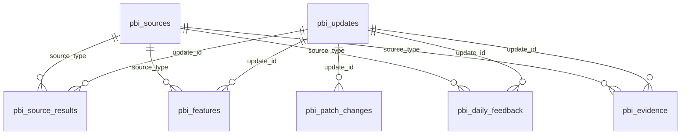

# Power BI report

The report imports seven PostgreSQL views whose names start with `pbi_`. They are the stable contract between the pipeline and Power BI: the pipeline can change its tables, but these views keep their names, columns and grain. The DAX measures are in [`powerbi/measures.dax`](../powerbi/measures.dax) and the colour theme is in [`powerbi/theme.json`](../powerbi/theme.json).

Power BI Desktop is free and runs on Windows. The report uses **Import** mode, which means it keeps a copy of the data and shows new results only after you click **Refresh**.

## Data model

Each view shows only the **latest completed or partial run of each update**, so `update_id` on its own identifies an update and every relationship uses a single column. Timestamps are UTC.

| View | One row per | Role |
| --- | --- | --- |
| `pbi_updates` | update | Lookup (dimension): title, window, as-of time, overall label, caveats, `data_kind` (live or synthetic demo) |
| `pbi_sources` | source (Steam reviews, update-page comments) | Lookup (dimension) |
| `pbi_source_results` | update and source | Label, author populations, coverage, exclusions by reason, collection status |
| `pbi_features` | update, source, tier and feature | Distinct authors, polarity split, share with its denominator, recurring status, example quotes |
| `pbi_daily_feedback` | update, source and day since release | Item counts, text sentiment and Steam recommendations per day |
| `pbi_evidence` | quoted observation | Evidence quotes with links back to Steam |
| `pbi_patch_changes` | update and patch-note change | The changes the model was given, numbered C1, C2 and so on |



**Why some author numbers are blank in totals.** Distinct-author counts come from SQL. They can't be added up: the same person can post during several updates and in both sources, so two updates with 50 authors each don't make 100 people. The author measures therefore show a value only when a visual narrows to one row of their view (one update and one source, plus one feature for feature measures), and stay blank in totals. Item counts, such as eligible or analyzed items, can be added up and have normal totals.

## Build the report

### 1. Get the data ready

From the project folder:

```powershell
.venv\Scripts\python -m steam_analyzer initdb   # creates or refreshes the pbi_ views
.venv\Scripts\python -m steam_analyzer demo     # optional: the synthetic demo game
```

You also need at least one run that has finished with a **completed** or **partial** status, started from the control panel or with `run`.

### 2. Install Power BI Desktop

Open the Microsoft Store, search for **Power BI Desktop** and install it (free).

### 3. Connect to PostgreSQL

1. **Home → Get data → More… → Database → PostgreSQL database → Connect.**
2. Server: `localhost`. Database: `steam_analyzer`. Data Connectivity mode: **Import**. Click OK.
3. In the credentials window, choose the **Database** tab. Use the read-only `steam_reader` login if you created it (see the README), or the user and password from `DATABASE_URL` in your `.env`.
4. If Power BI says it can't connect with encryption and asks to connect without it, click OK. The database is on your own computer, and a local PostgreSQL install doesn't use SSL by default.
5. In the Navigator, tick the seven `pbi_` views (not the `v_` views or the tables) and click **Load**.

### 4. Rename the tables

Power BI may put the schema in front of each name, for example `public pbi_updates`. If it does, double-click each table in the **Data** pane on the right and rename it to the view name (`pbi_updates`). The measures use these names.

### 5. Relationships

Open **Model view** (the third icon on the left), then **Manage relationships**. Power BI may have created some relationships automatically. Delete any that aren't in this list, then add the missing ones. Every relationship is **Many to one (\*:1)**, **Single** cross-filter direction and **Active**.

| From (many side) | To (one side) |
| --- | --- |
| `pbi_source_results[update_id]` | `pbi_updates[update_id]` |
| `pbi_features[update_id]` | `pbi_updates[update_id]` |
| `pbi_daily_feedback[update_id]` | `pbi_updates[update_id]` |
| `pbi_evidence[update_id]` | `pbi_updates[update_id]` |
| `pbi_patch_changes[update_id]` | `pbi_updates[update_id]` |
| `pbi_source_results[source_type]` | `pbi_sources[source_type]` |
| `pbi_features[source_type]` | `pbi_sources[source_type]` |
| `pbi_daily_feedback[source_type]` | `pbi_sources[source_type]` |
| `pbi_evidence[source_type]` | `pbi_sources[source_type]` |

Filters flow from the two lookup tables to the data tables and never from one data table to another. That keeps every update's window and denominator separate.

### 6. Column settings

Select a column in the Data pane, then change it in **Column tools** at the top:

- `pbi_sources[source_name]`: **Sort by column → sort_order**.
- `pbi_evidence[permalink]` and the `*_example_link` columns in `pbi_features`: **Data category → Web URL**, so tables can show them as links.
- `update_id`, `run_id`, `day_number`, `position` and `change_number`: **Summarization → Don't summarize**. Otherwise Power BI adds IDs together when you drag them into a visual.

### 7. Measures

1. Open **DAX query view** (the fourth icon on the left) and start a new query.
2. Paste all of `powerbi/measures.dax` and click **Run**. A small table appears with one row per update and source.
3. Click **Update model with changes**. The measures appear under their tables in the Data pane.
   - If your version doesn't have that button, add each measure with **Home → New measure**, pasting the text after `MEASURE table[Name] =`.
4. Format the percentage measures. Select each one and set **Measure tools → Format → Percentage**:
   - Analysis coverage
   - Cache hit rate
   - Steam recommendation share
   - Positive, Negative and Mixed authors %
   - Mention share
   - Positive and Negative text share
   - Daily recommendation share

### 8. Theme

**View → Themes → Browse for themes →** `powerbi/theme.json`.

The colours come from a colour-blind-safe palette: Positive is blue (#0072B2), Negative is vermillion (#D55E00), Mixed is purple (#CC79A7), and Insufficient or uncertain is grey.

### 9. Pages

Put a card showing **Data notice** at the top of every page, so synthetic demo data is always labelled when it's in view.

**Page 1: Update overview**

- Slicer: `pbi_updates[data_kind]`.
- Cards: **Updates**, **Eligible items**, **Analyzed items**, **Analysis coverage**.
- Table: `title`, `version`, `window_start_utc`, `window_end_utc`, `window_status`, `as_of_utc`, `run_status`, `capped_sample`, `overall_label`, `basis`, `reviews_label`, `comments_label` and `caveats`, plus the measures **Eligible items** and **Analysis coverage**.
- Colour the label: open the table's **Cell elements**, choose `overall_label`, and turn on **Background color**. Set **Format style → Field value** and pick the **Overall label color** measure.

**Page 2: Update detail**

- Slicers: `pbi_updates[title]` and `pbi_sources[source_name]`, both with **Single select** turned on.
- Cards:
  - **Overall label** and **Source label**. Colour the callout value with **Source label color** using the same Field value method as page 1.
  - **Qualifying authors** and **Analyzed authors**.
  - **Positive authors %**, **Negative authors %** and **Mixed authors %**.
  - **Steam recommendation share**.
- Clustered bar chart for the main reasons:
  - Y-axis: `pbi_features[feature_key]`.
  - X-axis: **Praise authors**, **Criticism authors** and **Divided authors**.
  - Tooltip: **Share with denominator**.
  - Visual filter: `tier` is `patch_related`.
- Table of reasons: `feature_key`, `category`, `support`, **Share with denominator**, `change_text`, `positive_example` and `negative_example`, with the same `tier` filter. Copy it, change the filter to `tentative` and `general`, and title the copy "Other topics (not used for the verdict)".
- Table of patch changes: `pbi_patch_changes[change_id]`, `section` and `text`, sorted by `change_number`.

**Page 3: Feedback timeline**

- Slicers: update (single select) and source.
- Line and clustered column chart:
  - X-axis: `pbi_daily_feedback[day_number]`.
  - Columns: **Items**.
  - Lines: **Positive text share** and **Negative text share**.
- Line chart: **Cumulative items** by `day_number`. For reviews, you can add **Daily recommendation share**.
- Cards for the release boundaries: `window_start_utc`, `window_end_utc` and `window_status`. Add this text box: *"Day 0 starts at the release time. The window ends at the next release, or at the run cutoff for the latest (ongoing) update. Days with no feedback don't appear. Counts are items, not people."*

**Page 4: Evidence and coverage**

- Slicers:
  - update and source;
  - `pbi_evidence[sentiment]` and `pbi_evidence[tier]`;
  - `pbi_evidence[feature_key]`, with **Search** turned on in the slicer's ⋯ menu.
- Evidence table: `feature_key`, `sentiment`, `tier`, `evidence`, `change_text`, `author_known`, `created_at_utc` and `permalink`. For `permalink`, turn on **URL icon** under the table's Format → Values.
- Coverage table:
  - Name and source: `pbi_updates[title]` and `pbi_sources[source_name]`.
  - From `pbi_source_results`, collection and label: `collection_status`, `capped` and `insufficient_reason`.
  - From `pbi_source_results`, item counts: `collected`, the four `excluded_*` columns, `eligible`, `analyzed`, `failed`, `pending`, `coverage` and `unknown_author_items`.
- Text box: *"Model accuracy has not been measured against human labels yet. AI-derived labels are exploratory."*

### 10. Refresh after a run

1. Run the analysis from the control panel (or the CLI) and wait for the status **completed** or **partial**.
2. In Power BI, click **Home → Refresh**.

The Run button only updates PostgreSQL. Power BI shows the new results after you refresh. When an update has a newer finished run, that run replaces the older one in every view.

### 11. Save

Use **File → Save as** and choose the **Power BI project (.pbip)** type. Save it in this repo's `powerbi/` folder. A project is a set of text files that works with git.

Before committing, check that the project folder has a `.gitignore` that leaves out `.pbi/cache.abf` and `.pbi/localSettings.json`. Power BI normally creates it, and the cache holds a copy of the imported Steam text.
